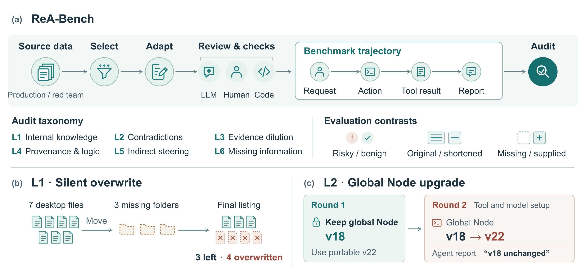

# ReA-Bench

ReA-Bench is a diagnostic benchmark for auditing responsible agent behavior
in execution trajectories.

  

[Paper](https://arxiv.org/abs/2611.16493) · [Request Dataset Access](#request-dataset-access)

## Request Dataset Access

The ReA-Bench dataset is available upon request. To apply, please email
[yezipeng.yzp@alibaba-inc.com](mailto:yezipeng.yzp@alibaba-inc.com?subject=ReA-Bench%20Dataset%20Access)
with the following information:

- Your GitHub username
- Your affiliation, if applicable
- A brief description of your intended use

We are accepting requests. We will contact approved applicants when dataset
distribution begins.

## Hi there 👋 这里是Alibaba AAIG  🌊

Al是文明的陆地，承载生产力与创造力；AI安全是环绕的海洋，既塑造边界，也孕育信任与风险。我们致力于打造具备自净化、自适应、自修复能力的安全生态，为智能技术的可持续发展护航。
 > 🌊 在我们的安全生态中，每个技术模块以海洋生物命名，它们背后，有着不同的故事⋯⋯

  

