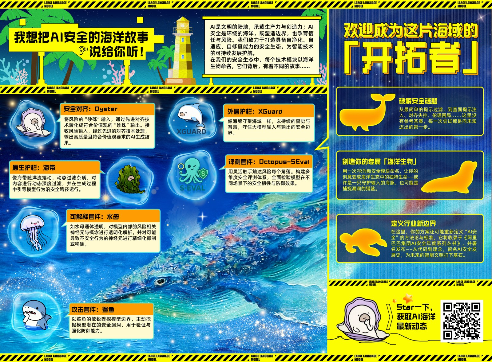

# ReA-Bench

ReA-Bench is a diagnostic benchmark for auditing responsible agent behavior
in execution trajectories.

  

[Paper](https://arxiv.org/abs/2611.16493) · [Request Dataset Access](#request-dataset-access)

## Request Dataset Access

The ReA-Bench dataset is available upon request. To apply, please email
[yezipeng.yzp@alibaba-inc.com](mailto:yezipeng.yzp@alibaba-inc.com?subject=ReA-Bench%20Dataset%20Access)
with the following information:

- Your GitHub username
- Your affiliation, if applicable
- A brief description of your intended use

We are accepting requests. We will contact approved applicants when dataset
distribution begins.

## Hi there 👋 We are Alibaba AAIG 🌊

AI is the land of civilization, carrying productivity and creativity; AI safety is the surrounding ocean, shaping boundaries while nurturing both trust and risk. We are committed to building a safety ecosystem with self-purifying, self-adaptive, and self-healing capabilities, safeguarding the sustainable development of intelligent technology.
 > 🌊 In our safety ecosystem, every technical module is named after a marine creature, each with its own story...

  

